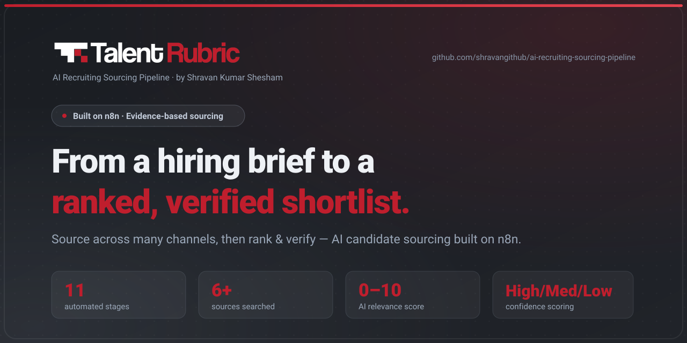
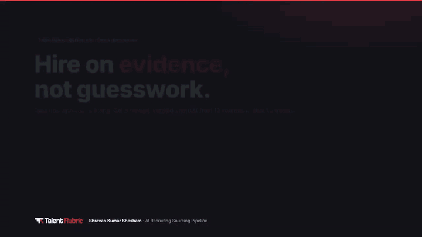
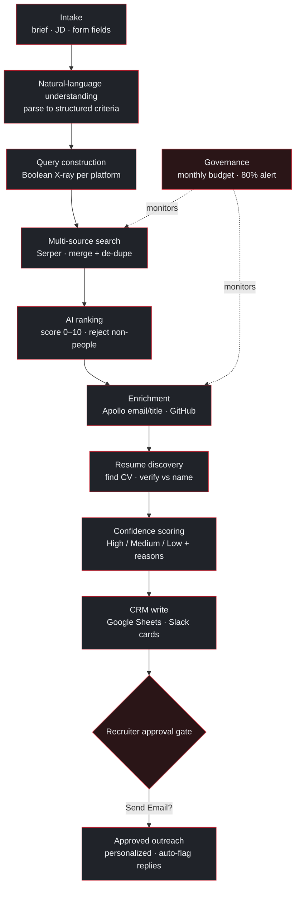

<p align="center">
  <a href="#-live-demo-optional">
    
  </a>
</p>

<p align="center">
  
</p>

[](./LICENSE) [](https://github.com/shravangithub/ai-recruiting-sourcing-pipeline/stargazers) [](https://shravangithub.github.io/ai-recruiting-sourcing-pipeline/) [](https://n8n.io)

# AI Recruiting Sourcing Pipeline

**Built by Shravan Kumar Shesham · 2026** · [LinkedIn](https://www.linkedin.com/in/shravanskumar/) · Licensed under [MIT](./LICENSE)



▶ **[Watch the demo](https://shravangithub.github.io/ai-recruiting-sourcing-pipeline/#demo)** — see the pipeline turn a brief into a ranked, verified shortlist. ([direct MP4](https://shravangithub.github.io/ai-recruiting-sourcing-pipeline/demo.mp4))

[](https://shravangithub.github.io/ai-recruiting-sourcing-pipeline/#demo)

An evidence-based, AI-powered candidate **sourcing** pipeline built on [n8n](https://n8n.io) —
it **sources across many channels, then ranks and verifies.**

It turns a plain-English hiring brief (or an uploaded job description) into a ranked, enriched,
confidence-scored shortlist of real candidates — sourced from LinkedIn, GitHub, GitLab, Stack Overflow,
Kaggle, Hugging Face, Hacker News, Apollo, X, Reddit and the open web — and manages recruiter-approved
outreach end to end.

> **Why this exists.** Modern talent acquisition increasingly rewards recruiters who can *build*,
> not just operate an ATS. This project is my working proof of that: a production sourcing pipeline
> I designed, debugged, and hardened myself — with an emphasis on **data quality, judgment, and
> respecting the limits of automation**, not "AI will replace recruiters" hype.

---

## Quick links

- Live demo / docs: **[shravangithub.github.io/ai-recruiting-sourcing-pipeline](https://shravangithub.github.io/ai-recruiting-sourcing-pipeline/)** (source in `docs/index.html`)
- **One-click setup (recommended):** [`SETUP.md`](SETUP.md) – paste your keys, your n8n configures itself
- Importable n8n template (manual setup): `setup/pipeline.workflow.json` (the original
  `ai-recruiting-pipeline.template.json` is kept as the build source)
- What's new: [What's new (October 2026)](#whats-new-october-2026)
- Release notes: [`RELEASES/v1.0.md`](RELEASES/v1.0.md)

---

## Table of contents

- [What's new (October 2026)](#whats-new-october-2026)
- [Pipeline architecture](#pipeline-architecture)
- [The results sheet](#the-results-sheet)
- [Sources and what each one gives you](#sources-and-what-each-one-gives-you)
- [Key features](#key-features)
- [Responsible use & data privacy](#responsible-use--data-privacy)
- [Getting started (3–5 minutes)](#getting-started-3-5-minutes)
- [Quick start (1–2 commands)](#quick-start-1-2-commands)
- [Install & usage](#install--usage)
- [Demo & assets](#demo--assets)
- [Troubleshooting / FAQ](#troubleshooting--faq)
- [Running the tests](#running-the-tests)
- [Contributing](#contributing)
- [License](#license)

---

## What's new (October 2026)

- **v1.8: where recruiters already are** (see [`RELEASES/v1.8.md`](RELEASES/v1.8.md)): an **Add to Board**
  button for the browser, forwarding a CV or profile link by email, voice notes on Telegram, and the app on
  a phone's home screen, signed in for 30 days. All score with the same prompt as a search. Name channels in a
  Telegram brief to pick them; "Search: <role>" by email starts a search.
- **v1.7: source from your phone, on Telegram** (see [`RELEASES/v1.7.md`](RELEASES/v1.7.md)): text a brief
  to start a search, get the top 5 when it finishes, shortlist or approve by number, and answer candidate
  replies with a drafted message. No public address needed.
- **v1.6: a public apply page for every role** (see [`RELEASES/v1.6.md`](RELEASES/v1.6.md)): open it per role on the Board,
  share the link, and applicants are scored like everyone else and land in Found, marked Applied.
  Reaching it from the internet: [`docs/PUBLIC-ACCESS.md`](docs/PUBLIC-ACCESS.md).
- **v1.5: run it without worrying** (see [`RELEASES/v1.5.md`](RELEASES/v1.5.md)): a Health page that says what
  is stuck and how to fix it (searches, follow-up and first-email jobs, sending limits, bounces,
  channels), a Monday email report for admins, and a backend map ([`docs/BACKEND.md`](docs/BACKEND.md)).
- **v1.4: more places to find people, all free** (see [`RELEASES/v1.4.md`](RELEASES/v1.4.md)): research
  papers (industry researchers via OpenAlex), speakers & experts (Sessionize, Google Developer Experts,
  Microsoft MVPs, AWS Heroes), a veterans-only search, target companies with a Map view, and past
  candidates who fit a new role, added in one click. Also fixes Google's new hidden result links and
  keeps each person's company.
- **v1.3: a smarter Board** (see [`RELEASES/v1.3.md`](RELEASES/v1.3.md)): read a candidate's reply and
  draft an answer with your free calendar slots, send it from Gmail in the same thread; interview
  questions and a scorecard per person; a pulse and reply forecast per role; "what if" counts for each
  must-have; find more people like your shortlist; warm intros through teammates' past companies; who
  else is on the board; a `/` command bar; no repeat emails within 90 days; optional open tracking.
- **v1.2: a team workspace** (see [`RELEASES/v1.2.md`](RELEASES/v1.2.md)):
  - **Team logins**: each person signs in with their own email and password. Roles are *admin*
    (manages the team, sending settings and follow-up emails) and *recruiter* (searches, reviews,
    approves). Passwords are stored as salted PBKDF2-SHA256 in your n8n (Data Table `app_users`),
    sessions last 7 days, and an activity log records who searched, approved, edited or invited whom.
    The first admin proves ownership with the old access code once.
  - **Home**: this week's numbers, what needs your attention (replies, fresh strong matches, bounces),
    best sources by replies, team activity and a getting-started checklist.
  - **Settings**: your account and password; team (add people with a one-time password, change roles,
    reset passwords, turn accounts off); sending (signature, window, daily limit, weekdays only, used
    by the follow-ups); and connected services with when each last worked.
- **v1.1: more channels, non-tech roles, a smarter app** (see [`RELEASES/v1.1.md`](RELEASES/v1.1.md)):
  - **10 new sources**: Devfolio, Unstop, Devpost and HackerEarth (hackathons); LeetCode, CodeChef and
    Codeforces (competitive programming, with each Codeforces profile's name, city and rating from
    Codeforces' free API); Topmate, ADPList and Medium (product managers and other non-tech roles).
  - **Non-tech roles**: title variants for product, program, sales, marketing, HR, finance, operations
    and customer success; an optional **Colleges** filter; scoring that weighs scope, outcomes, team size
    and domain instead of code.
  - **App**: a *why they match* panel quoting the profile for each must-have, votes that re-rank the
    shortlist, and an editor for the follow-up emails.
- **The sourcing app** – open `https://<your-n8n>/webhook/sourcing-app` for a real product
  instead of forms and a spreadsheet:
  - **One search screen with an AI intake agent.** Paste a brief or JD; it fills role, must-haves,
    nice-to-haves, experience, location and exclusions as you type, asks up to 2 clarifying
    questions when the answer would change the search (never about gender, age or other protected
    attributes), and writes a scoring rubric that the scoring AI then uses.
  - **Live run screen** with the pipeline's real progress.
  - **Shortlist** with an honest match % (the AI's score, adjusted by what the checks found: years,
    must-haves actually seen, location), per-criterion checks, thumbs up/down, and
    **Approve for outreach**, which ticks *Send Email?* so the first email and the day 2/4/5/7
    follow-ups take over.
  - **Outreach** view of every sequence.
  - Protected by a team access code chosen on first visit. Data stays in your n8n (Data Tables
    `app_runs`, `app_candidates`, `app_feedback`, `app_settings`) and your Google Sheet.
- **Outreach sequences** – after the first email, each person gets up to four follow-ups as
  replies in the same Gmail thread, **2, 4, 5 and 7 days** later. Every follow-up first checks the
  thread: a reply (or a bounce) stops the sequence at once. Weekdays 9:30–18:30 IST only, at most
  50 a day. Fixed templates, no AI, so no token cost. State lives in an n8n Data Table
  (`outreach_sequence`); the wording lives in `outreach_templates` (edit it in n8n → Data tables;
  placeholders `{first_name}` `{role}` `{in_location}` `{at_company}`). The sheet's
  **Outreach Status** shows where each person is, e.g. *"Follow-up 2 of 4 sent · next 3 Nov"*.
  To stop someone by hand, set their row's `status` to `stopped` in the Data Table.
- **Brief-first search form** – page 1: describe the person (and add a JD). Page 2: *"Here's what
  we'll search for"* – every field pre-filled from the brief, editable, with sources as tiles
  pre-ticked for the role. Only the ticked sources are searched.
- **About a minute per search** – AI scoring runs all batches at the same time.
- **Every Google query fits Google's 32-word limit** – exclusions are trimmed first; job ads and
  job boards are dropped after the search instead.
- **More contacts** – GitHub developers who hide their profile email get their public commit email
  (noreply addresses ignored).
- **Per-source counts** – the requisition row says how many people each source found.
- **One-click setup** – paste your keys into a setup page and your own n8n configures itself
  (connections, results sheet, CV folder, pipeline). See [`SETUP.md`](SETUP.md).
- **Runs free on your own computer** – self-hosted n8n in Docker includes everything the setup needs;
  no n8n subscription required.
- **Every source is searched and every person is ranked** – all sources finish before ranking, the AI
  scores the whole pool in batches, and profiles it skips are put back for review.
- **Location you can trust** – people in the city you searched come first; nobody is dropped just
  because their profile doesn't show a city. Only people clearly in another country are removed.
- **Kaggle, Stack Overflow, Hugging Face and GitLab by city** – searched through Google, where their
  profile pages show where people live. Rows from platforms that can't confirm a location are
  highlighted for the recruiter to check.
- **A cleaner sheet** – a requisition row above each search, a Search Geography column, a Location
  Review column and light whole-row colours (see [The results sheet](#the-results-sheet)).
- **Honest spend limits** – when the monthly Apollo allowance runs out, searches carry on without
  Apollo (and the sheet says so); if the Google search allowance runs out, the Search Log shows
  "Paused" instead of failing silently.
- **Sturdier runs** – empty Google pages are retried, resumes must carry the person's name, only real
  CV files are downloaded, and a search with no results always closes its Search Log row.
- **Automated tests** covering wiring, sheet columns and every step with realistic recruiter inputs.

---

## Pipeline architecture

One pass, eleven stages — from a plain-English brief to recruiter-approved outreach, with a
governance layer watching API spend throughout.



---

## What it does (in one pass)

1. **Intake** — a recruiter describes the person in plain English and (optionally) pastes or uploads
   a job description (PDF/Word).
2. **Natural-language understanding** — an LLM parses the brief/JD into structured criteria, shown
   back on a second form page (role, skills, experience, city, region, filters, sources) for the
   recruiter to confirm or change before anything is searched.
3. **Query construction** — a Boolean "X-ray" search string is built per target platform
   (LinkedIn, GitHub, Stack Overflow, etc.), with synonym expansion, exclusions, education filters,
   and a job-post noise filter so the search returns *people*, not job ads.
4. **Multi-source search** — paginated search (via [Serper](https://serper.dev)) across the selected
   platforms and the open web, results merged and de-duplicated.
5. **AI ranking** — every result is scored 0–10 against the criteria/JD, with a hard experience-minimum
   filter and explicit rules to reject job postings, directories, and non-person pages.
6. **Enrichment** — top candidates are enriched with verified work email/title/company (Apollo) and
   public GitHub profile data; LinkedIn-less candidates skip paid enrichment to save credits.
7. **Resume discovery** — a targeted secondary search hunts for a downloadable CV, scored for
   relevance and **verified against the candidate's name** before it's trusted.
8. **Confidence scoring** — every candidate gets a High/Medium/Low confidence label with reasons,
   so a recruiter knows which rows to trust.
9. **CRM write** — candidates are written to a Google Sheet (30+ fields) under a requisition row for
   the search (with candidates per source); a person found again for the same requisition is updated in place, keeping the
   recruiter's ticks. Slack cards are optional.
10. **Approved outreach** — the recruiter ticks "Send Email?" on chosen rows; a scheduler sends a
    personalized outreach email, marks the row "Contacted", then follows up on days 2, 4, 5 and 7
    in the same thread until the person replies; a mail trigger auto-flags "Replied".
11. **Governance** — monthly API-credit budget tracking with auto-reset and an 80% near-cap alert.
    Running out of Apollo lookups never stops a search; running out of Google searches pauses it and
    says so in the Search Log.

---

## The results sheet

Each search writes a **requisition row** (light indigo) followed by its candidates:

| Row | What it shows |
|---|---|
| Requisition | Role, 📍 geography, must-have and nice-to-have skills, experience, education, industry, employer, exclusions, platforms, whether a JD was used, how many candidates (in the city / country only / to review) and when it ran |
| Light green | Candidate's profile shows the city you searched |
| Light yellow | Only the country is known, or the profile shows no location (found by the city search) |
| Light orange | From a platform that can't filter by location (Kaggle, Stack Overflow, Hugging Face, GitLab, Hacker News, Dev.to, Reddit) – **recruiter to check the profile** |

Useful columns: **Fit Score** (1–10), **Location Review** (the colour reason in words),
**Search Geography** (what the recruiter searched), **Confidence** (High / Medium / Low with reasons),
**Send Email?** (tick to approve outreach). The **Search Log** tab shows each run as Processing,
Complete (with counts) or Paused.

---

## Sources and what each one gives you

| Source | How it's searched | Key needed |
|---|---|---|
| LinkedIn | Google X-ray (`site:linkedin.com/in`) with title synonyms, skills and city aliases | Serper |
| GitHub | GitHub user search by language and location, then each profile (name, company, public email, site) | GitHub token (recommended) |
| Apollo | People search by title, city and seniority; email/title lookup for Apollo rows and the top 25 LinkedIn rows | Apollo (optional) |
| Kaggle | Kaggle API (top notebooks) plus Google search of Kaggle profiles in the city | Kaggle **legacy** API key + Serper |
| Stack Overflow / Hugging Face / GitLab | Google search of profiles in the city (GitLab's own search only matches usernames) | Serper |
| Hacker News | "Who wants to be hired" posts that mention the city | none |
| Open web | Google search for CVs, portfolios and personal sites | Serper |
| X, Dribbble, Behance, Reddit | Google X-ray | Serper |
| Devfolio, Unstop, Devpost, HackerEarth | Google search of profile pages (one search per site), by skills and city | Serper |
| LeetCode, CodeChef, Codeforces | Google search of profile pages by city; Codeforces profiles are filled in from Codeforces' free API (name, city, organisation, rating) | Serper |
| Topmate, ADPList, Medium | Google search of profile and mentor pages by job title and city | Serper |

Phone numbers, education and gender are rarely public, so those columns are often empty.

---

## Key features

- Boolean X-ray search automation (Google/Bing/X-ray queries)
- LLM-based ranking and scoring of candidate matches
- Data enrichment (profiles, company, contact where available)
- Confidence scoring and recruiter review flow
- Export to CSV/ATS and optional outreach automation

## Responsible use & data privacy

This pipeline handles personal data about real candidates, so it is built to keep a human in
control and to minimize what it collects and retains.

- **Recruiter-in-the-loop by design.** The system ranks and enriches, but never contacts anyone on
  its own — outreach only sends after a recruiter explicitly ticks "Send Email?" on a row. AI scores
  are decision *support*, not decisions.
- **Credentials stay in n8n.** API keys and tokens live in n8n's credential store, never in this repo
  or the exported template (which ships with `YOUR_*` placeholders). Don't commit real secrets. The
  one-click setup runs inside your own n8n, passes keys straight into that credential store, and has
  execution logging switched off so keys never appear in your execution history.
- **Data minimization.** Only publicly available professional data is used; enrichment is credit-aware
  and skipped where it isn't needed; and the confidence labels exist so recruiters can set aside
  low-trust rows rather than act on them.
- **Bias & fairness.** Boolean and AI matching can inherit bias from queries and sources. Keep criteria
  job-related, review the shortlist yourself, and treat scores as one signal among many — this tool is
  meant to widen and speed sourcing, not to auto-reject people.
- **Compliance is your responsibility.** Depending on jurisdiction, sourcing and outreach may fall under
  GDPR, CCPA, or local employment law (lawful basis, data-subject requests, retention limits, outreach
  consent). Configure retention, opt-outs, and record-keeping to fit your obligations.

## Getting started (3–5 minute walkthrough)

1. Clone the repo
2. Open `docs/index.html` for a self-contained demo of flow and output
3. Import the n8n workflow into your n8n instance (see Install & usage below)

## Quick start (1–2 commands)

```bash
# clone and open demo in your browser (works locally)
git clone https://github.com/shravangithub/ai-recruiting-sourcing-pipeline.git
# open demo
xdg-open ai-recruiting-sourcing-pipeline/docs/index.html || open ai-recruiting-sourcing-pipeline/docs/index.html
```

## Install & usage

**Easiest: one-click setup.** Import [`setup/setup.workflow.json`](setup/setup.workflow.json) into
your n8n, switch it on and open its setup page. Paste your keys, sign in to Google, click
**Configure my pipeline** – done in about 5 minutes. Full guide: [`SETUP.md`](SETUP.md).

**Manual setup** (if you'd rather wire it yourself):

1. Install n8n: https://docs.n8n.io/getting-started/installation/
2. Import [`setup/pipeline.workflow.json`](setup/pipeline.workflow.json) (n8n → **Import from File**).
   It is the ready pipeline with placeholders: create the credentials named `Sourcing · OpenAI`,
   `Sourcing · Serper`, `Sourcing · GitHub`, `Sourcing · Google Sheets`, `Sourcing · Google Drive`,
   `Sourcing · Gmail` (others optional), then replace `__SHEET_ID__`, `__DRIVE_FOLDER_ID__`, `__COMPANY__`,
   `__SIGNATURE__` and the `__CRED_…__` ids. The one-click setup does all of this for you.
3. Publish the workflow and open its form.

(`ai-recruiting-pipeline.template.json` is the original build source, kept for history – don't import it.)

## 💬 Live Demo (optional)

This project includes **TalentRubric Scout**, a conversational sourcing chat
(n8n Chat Trigger → AI criteria parsing → Serper X-ray search → AI ranking).

The public demo is **off by default** so it doesn't consume the maintainer's
API credits. To run it yourself:

1. Import the workflow into your own n8n instance.
2. Add your own **Serper** API key and OpenAI credential (or use n8n credits).
3. **Publish** the workflow and open the Chat Trigger's chat URL
   (`/webhook/<your-id>/chat`) — that's your live demo link.

## Demo & assets

- `docs/index.html` — static demo/landing page (also published via GitHub Pages).
- `assets/social-preview.svg` — social preview image (upload to repo Settings → Social preview).
- `assets/demo.gif` — animated demo of the pipeline producing a ranked, confidence-scored shortlist.
- `assets/demo-placeholder.svg` — original static placeholder (superseded by `demo.gif`).

## Troubleshooting / FAQ

Q: What LLMs are supported?
A: The pipeline uses a generic LLM ranking step — configure your preferred provider (OpenAI, Anthropic, or local model) by setting the provider credential in n8n.

Q: How do I scale to large volumes?
A: Use pagination in the search steps, batch enrichment requests, and consider a queue (Redis / n8n queue) for enrichment & scoring. Caching enrichment results reduces API usage.

## Running the tests

```bash
python3 setup/build_pipeline.py    # rebuild setup/pipeline.workflow.json from the template + fixes
python3 setup/build_setup.py       # rebuild setup/setup.workflow.json
node --test tests/*.test.js        # wiring, sheet columns and every step with recruiter-style inputs
```

The step tests run each n8n Code node outside n8n (`tests/harness.js`), so they need no n8n or keys.
Steps that use dates need `luxon` (`npm i luxon`, or point `NODE_PATH` at an n8n install).

## Contributing

Contributions welcome — see [CONTRIBUTING.md](CONTRIBUTING.md) for guidelines.

## License

This project is licensed under the MIT License — see [LICENSE](./LICENSE).
